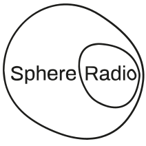

<h1 align="left">
  Sphere Radio LibreTime Tagger
  <picture>
    <source media="(prefers-color-scheme: dark)" srcset="docs/sphere-logo-white.svg">
    <a href="https://sphere-radio.net"></a>
  </picture>
</h1>

A small web app that tags MP3 files for the <a href="https://sphere-radio.net">Sphere Radio</a> LibreTime library.

The app asks only for what LibreTime needs, so tags and file names are always consistent.

> [!NOTE]
> Everything runs in your browser. Your audio files are never uploaded anywhere.

## Features

- **Add clean tags:** the app only asks for the info the Sphere Radio tagging scheme can accommodate. It embeds these tags in a way LibreTime can read and removes leftover tags.
  - show
  - episode (and optional title)
  - contributors
  - broadcast date
  - cover art
- **Automatically compile title tag and file name:** both the title tag and the file name are combined from your show, episode, contributors etc. The app creates them automatically for you.
- **Show list:** most users will always tag the same show. The app stores added shows in a list, so shows with complicated special characters only have to be added once. This ensures consistent spelling, capitalization, and special characters.
- **Per-show defaults:** the next episode number, primary contributors and primary cover are filled in for you
- **Cover cropping:** drag a square frame over the image to see exactly what is cut off. The result is saved as a JPEG up to 1400 × 1400 px  
- **Preview before saving:** the new file name and every tag are shown before anything changes

## What gets written

| Input | Tag | Example |
| --- | --- | --- |
| Show + episode + episode title + contributors + date | Title | `Nice Show - 23 - Christmas Special - DJ Mike, DJ Angela - 24.12.2012` |
| Show | Album | `Nice Show` |
| Contributors | Artist | `DJ Mike, DJ Angela` |
| Episode | Track number | `23` |
| Broadcast date | Composer | `24.12.2012` |
| Cover | Front cover (JPEG) | |

Empty optional parts are left out of the title. The file name is the title with characters that are not allowed in file names replaced by `_`. If it would exceed 100 characters (SoundCloud character limit), only the episode title is shortened, and only in the file name.

## Using the app

1. Choose or drop an MP3 file.
2. Pick your show. Use **New show** the first time.
3. Check the episode number, add an episode title if you have one, and add contributors.
4. Pick the broadcast date.
5. Add a cover image and move the frame to choose the cut.
6. Select **Review and save**, check the summary, then **Save**.

Press the **?** next to any field for a short explanation.

### Show profiles

Each show remembers:

- the last episode you saved, so the next one is suggested (and stays editable)
- its primary contributors. Press the ⭐️ on a name to mark it as primary (this contributor is automatically loaded upon selecting the show it is associated with)
- its primary cover. Tick **Use as the primary cover for this show** after choosing an image (also directly associated with the show)

Use the **primary** option when your show always has the same contributors or the same cover image. Everything remains editable in the tagger.

Use **Edit shows** to rename or delete shows and to clear a primary cover. Shows are stored in your browser, so each person and each browser has its own list. **Back up shows** and **Restore from backup** move the list between browsers or computers.

### Browser support

| Browser | Saving |
| --- | --- |
| Chrome, Edge, Opera | Renames and overwrites the original file (not tested, may also save a copy)|
| Firefox, Safari | Downloads a tagged copy. The original stays untouched |

> [!NOTE]
> The review dialog always says which of the two will happen.

## Customizing

| What | Where |
| --- | --- |
| Welcome message | `index.html`, the dialog `#welcomeDialog` (look for `EDIT HERE: welcome text`) |
| About text | `index.html`, the dialog `#aboutDialog` (look for `EDIT HERE: about text`) |
| Turn the first-visit popup off | `SHOW_WELCOME_ON_FIRST_VISIT` in `src/config.ts`. The footer's **Help** button keeps working |
| Accent color | `--brand` and `--accent` at the top of `src/styles.css`. Dark mode has its own lighter `--accent` in the `prefers-color-scheme: dark` block |
| Logo | `src/assets/sphere-logo.svg`, shown in the header. It is used as a mask, so it takes the text color in light and dark mode |

The first-visit popup is shown once per browser. Closing it stores the key `sphere-tagger-welcome-seen` in `localStorage`. Delete that key to see the popup again.

## Development

Requires Node.js 22 or newer.

Tags are written with [taglib-wasm](https://github.com/CharlesWiltgen/TagLib-Wasm), a WebAssembly build of TagLib.

```text
src/
  assets/   logo
  domain/   title, file name, tag and validation rules (no browser code)
  audio/    tag stripping and writing with TagLib
  cover/    crop math and JPEG rendering
  shows/    show profiles, storage and backup
  io/       choosing and saving files
  ui/       form, cover editor, dialogs
  config.ts switches you may want to change
tests/      unit tests, a jsdom test of the form and of the info dialogs
```

### Deployment

Every push to `main` runs the tests, builds the app and publishes `dist/` to GitHub Pages (see `.github/workflows/deploy.yml`).
